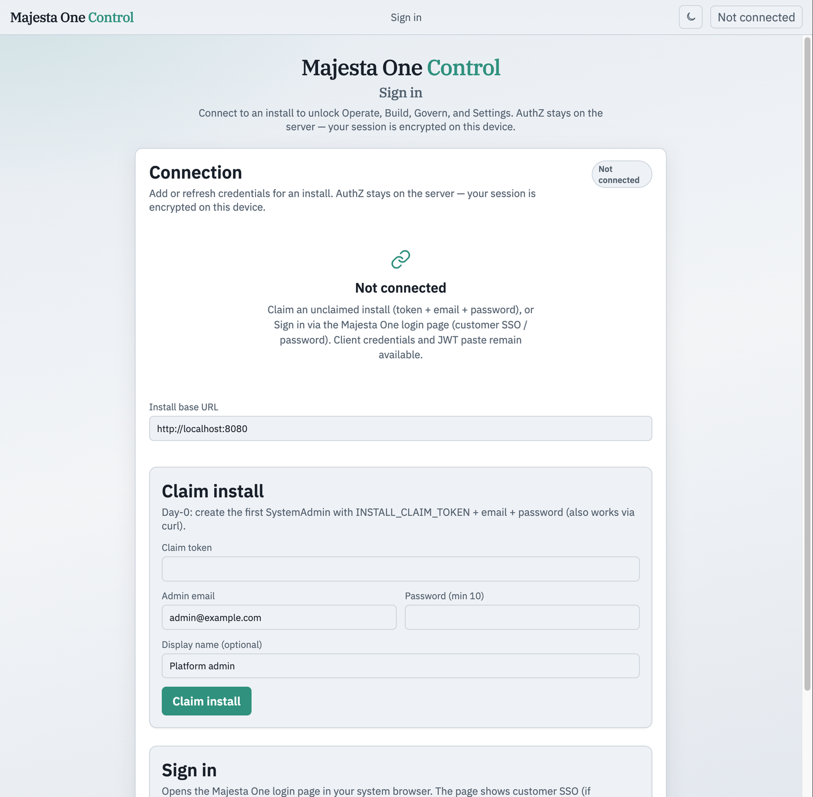
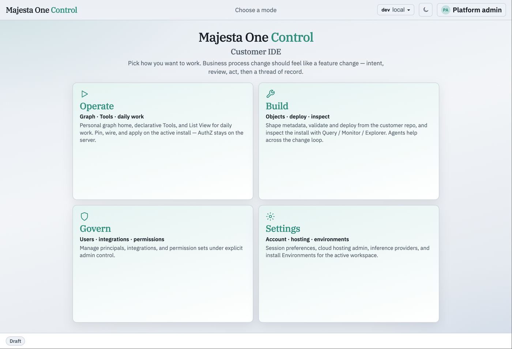
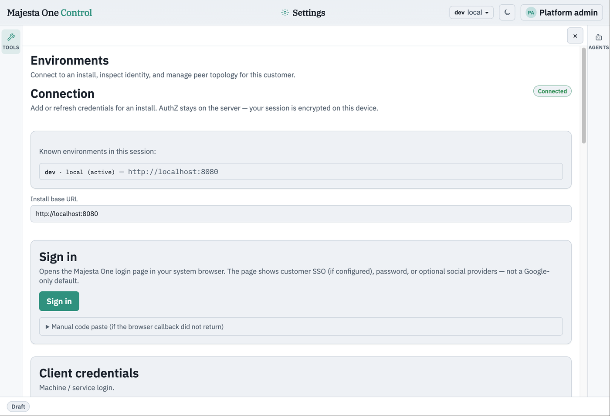

# Set up Majesta One on DigitalOcean

**Status:** alpha **0.1.0**. Contracts and packaging can still change.

This guide creates one production install on **DigitalOcean App Platform**, then connects **Majesta One Control** (Control IDE) from your computer to that install.

The install is the API, the worker, and one Managed PostgreSQL database. Control IDE is an optional desktop client. It does not run in the cloud, and it is not inside the product image. Builders can also use MCP and the `one` CLI ([builder-connect.md](./builder-connect.md)). Operators who want Compose or Helm should use [self-host.md](./self-host.md).

There is no Marketplace one-click. You deploy the App Spec yourself.

## What you need

- A DigitalOcean account and [`doctl`](https://docs.digitalocean.com/reference/doctl/) signed in (`doctl auth init`)
- A product release: container digests in `image-digests-X.Y.Z.txt` from the GitHub Release
- This repository, so you can copy `deploy/digitalocean/app.yaml` and run Control IDE
- Node.js **22.22.2** or newer on the computer that will run Control IDE

One install is one customer database and one public HTTPS URL. Start with a single production install. Add dev or test later if you need them ([multi-env-deploy.md](./multi-env-deploy.md)).

## 1. Create Managed PostgreSQL

In the DigitalOcean control panel, create a **Managed PostgreSQL 16** cluster in the same region as the app (the sample spec uses `nyc`). For a real install, choose a plan with a standby.

Use that managed database. Leave App Platform’s small development database unused.

When the cluster is ready, copy its connection string and keep `sslmode=require`. You will paste it as `DATABASE_URL`. Add the App Platform app as a trusted source after the app exists, so the API and worker can reach the database.

## 2. Prepare the App Spec

From a clone of this repository:

```bash
cp deploy/digitalocean/app.yaml /tmp/one-app.yaml
```

Edit `/tmp/one-app.yaml`:

| Field | Set it to |
|---|---|
| `CUSTOMER_ID` | A stable id for your organization, such as `acme` |
| `INSTALL_ID` | A unique id for this install, such as `acme-prod` |
| `INSTALL_ROLE` | `prod` |
| `PLATFORM_PUBLIC_URL` | The public HTTPS origin you will use, with no path |

`PLATFORM_PUBLIC_URL` must be the origin browsers and Control IDE call, for example `https://one-prod-xxxxx.ondigitalocean.app`. If you do not know the default ingress yet, put a placeholder, create the app, then update the spec with the live URL and run `doctl apps update`.

Pin the release images. Never leave the app on a floating `:latest` tag.

```bash
./scripts/apply-do-app-digests.sh image-digests-X.Y.Z.txt /tmp/one-app.yaml
go run ./scripts/validate-do-app-spec.go /tmp/one-app.yaml
```

`image-digests-X.Y.Z.txt` comes from the GitHub Release. The script sets the API and worker digests, the image tag, and `PRODUCT_VERSION`. Leave `API_REVISION_CURRENT` and `API_REVISION_MIN` at the values shipped in the spec (`1` / `1` for 0.1.0) unless that release says otherwise.

## 3. Create the app and set secrets

```bash
doctl apps create --spec /tmp/one-app.yaml
```

The spec marks secrets as `SECRET` and does not contain the values. In the App Platform UI, set the same secret on every component that lists it (`api`, and `worker` where the key exists):

| Secret | Value |
|---|---|
| `DATABASE_URL` | Managed Postgres connection string (`sslmode=require`) |
| `API_KEYS` | A random break-glass key of at least 32 bytes, with `+admin` on the end |
| `AUTH_JWT_SIGNING_KEY` | A random HMAC secret of at least 32 bytes |
| `INSTALL_CLAIM_TOKEN` | A random one-time claim secret (API only) |
| `WEBHOOK_ENCRYPTION_KEY` | A random secret of at least 32 bytes |
| `DEPLOY_SHARE_SECRET` | A random secret of at least 32 bytes (API only) |

Generate a secret with:

```bash
openssl rand -hex 32
```

`API_KEYS` is the break-glass key. Append `+admin` so the key has admin privilege, for example `$(openssl rand -hex 32)+admin`. Store it somewhere safe. Day-to-day sign-in uses the admin you claim in the next section, not this key.

Wait until the app is healthy, then confirm the public URL:

```bash
curl -fsS "$PLATFORM_PUBLIC_URL/healthz"
curl -fsS "$PLATFORM_PUBLIC_URL/readyz"
```

`/healthz` answers when the API is listening. `/readyz` answers after migrations and seed finish. If `/readyz` stays on `starting`, check `DATABASE_URL` and trusted sources.

Seed creates the managed `core` package and the Control IDE connected app (`one.controlIde`) because `AUTO_SEED` is `1`.

## 4. Run Control IDE on your computer

Control IDE stays on your machine and talks to the install over HTTPS.

```bash
cd tools/control-ide
npm ci
npm run electron:dev
```

An unsigned Mac disk image is available with `npm run dist:mac` (output under `tools/control-ide/dist/`). Signing and a download portal are not part of this release. `npm run dev` opens the same UI in a browser for layout checks; the desktop app is `electron:dev` or the packaged build.

## 5. Connect the IDE to the install

On the Sign in screen, set **Install base URL** to the public origin from step 3. Use `https://`, with no path and no trailing slash.

```text
https://one-prod-xxxxx.ondigitalocean.app
```

The screenshots below were taken against a local install, so the URL shows `http://localhost:8080` and the environment chip says `dev`. On App Platform, use your HTTPS origin. The environment chip then shows the `INSTALL_ROLE` from the spec (`prod`).



When the install has not been claimed, the **Claim install** card appears after the IDE reads `GET /auth/v1/install/status`:

1. **Claim token** — the `INSTALL_CLAIM_TOKEN` you set on the app
2. **Admin email** — the first SystemAdmin
3. **Password** — at least 10 characters
4. **Display name** — optional
5. **Claim install**

That call is `POST /auth/v1/install/claim`. It creates the admin and stores a Majesta One session on this computer. You can claim with curl instead, then use **Sign in** in the IDE:

```bash
curl -sS -X POST "$PLATFORM_PUBLIC_URL/auth/v1/install/claim" \
  -H 'Content-Type: application/json' \
  -d "{\"token\":\"$INSTALL_CLAIM_TOKEN\",\"email\":\"admin@example.com\",\"password\":\"choose-a-long-password\"}"
```

The claim token works once. Later sign-ins use **Sign in**, which opens the Majesta One login page in your browser (password, or customer SSO after you configure it).

If the claim card never appears, the URL is wrong or the install is already claimed. Fix the URL, or use **Sign in**.

After a successful claim or sign-in, the mode launcher opens. The account chip is the admin you just created.



Open **Settings**, then **Environments** (left tool rail). The badge reads **Connected**, and the known environment lists your install URL.



Closing the app keeps the session on this device (OS keyring, or a local encrypted file when the keyring is unavailable). The next launch opens the launcher directly. **Clear session** on the connection panel signs out.

Each install issues its own session. A production token does not sign you into another install.

## 6. Confirm the install

In **Settings → Environments**, choose **Refresh environment**. **This install** should show the customer, install id, and role you put in the App Spec.

From a shell, the same check is:

```bash
curl -sS "$PLATFORM_PUBLIC_URL/version"
curl -sS -H "Authorization: Bearer $ACCESS_TOKEN" "$PLATFORM_PUBLIC_URL/client/v1/me"
```

`$ACCESS_TOKEN` is the Majesta One JWT from claim or sign-in, or a token minted from the break-glass key. `GET /version` is public and includes `apiRevision`. Control IDE pins `One-API-Revision` from that value.

## Day to day

- **People and access:** Govern → Users, after you are signed in.
- **Customer SSO:** Settings is for the IDE session. Install SSO is `PUT /metadata/v1/install/auth` ([customer-connect.md](./customer-connect.md)).
- **Upgrades:** download the next `image-digests-X.Y.Z.txt`, apply it to your spec copy, then `doctl apps update <app-id> --spec /tmp/one-app.yaml`. Details: [product-upgrades.md](./product-upgrades.md) and [self-host.md](./self-host.md).
- **Agents and metadata from a repo:** [builder-connect.md](./builder-connect.md).

## If connect fails

| What you see | What to check |
|---|---|
| Claim card missing | URL must be the API origin. `GET /auth/v1/install/status` returns `claimed: false` only before the first claim. |
| Browser cannot reach the app | App deployment healthy, trusted sources include the app, `/readyz` returns success. |
| `API_REVISION_UNSUPPORTED` | IDE pin is outside the install’s `API_REVISION_MIN`–`API_REVISION_CURRENT` window. Match `GET /version`, or upgrade the image. |
| Sign-in returns to a blank page | `PLATFORM_PUBLIC_URL` must equal the origin you typed in Control IDE. Update the spec and redeploy if they differ. |
